# プロジェクト総合仕様書：『おもいでキャンバス v2.0』
**〜 Gemini Live × 生成AI × マルチモーダル見守りによる認知症予防・回想法対話システム 〜**

> [!abstract] ドキュメント概要
> 本仕様書は、双方向音声・映像対話AI（Gemini Live / Gemini 4 Argon API）と画像・動画生成AI（Imagen 3 / Veo）を組み合わせた、認知症予防・進行抑制・BPSD緩和のための対話システム『おもいでキャンバス』の企画書、臨床根拠、要件定義、基本設計、詳細仕様、医療安全ガードレール、および実装構造を網羅した**完全統合マスタードキュメント**です。
> （旧仕様書 v1.0、配布用PDF仕様書、プレゼンテーションスライド資料、概要解説ガイドの全内容を統合・更新しています）

---

## 目次

1. [企画・コンセプト（Project Proposal）](#1-企画コンセプトproject-proposal)
   - 1.1 ひとことで言うと、どんなアプリ？
   - 1.2 背景と解決する課題
   - 1.3 4つの臨床アプローチ（非薬物療法）
   - 1.4 システムコンセプトと価値提供サイクル
2. [要件定義（Requirements Definition）](#2-要件定義requirements-definition)
   - 2.1 ユーザーロールとユースケース
   - 2.2 機能要件一覧（FR-01 〜 FR-11）
   - 2.3 非機能要件（NFR-01 〜 NFR-05）
3. [基本設計・システムアーキテクチャ（Basic Design）](#3-基本設計システムアーキテクチャbasic-design)
   - 3.1 システム全体構成図
   - 3.2 フロントエンド画面設計（ご本人用「認知負荷ゼロ」2画面構成 ＆ 介護者ダッシュボード）
   - 3.3 バックエンドサーバー詳細仕様 ＆ 公開ホスティング構成
   - 3.4 非同期対話・画像生成・環境音シーケンス（会話を止めない設計）
   - 3.5 カメラ見守り＆表情・疲労フィードバックシーケンス
   - 3.6 誤検知防止付きSOS緊急通報シーケンス
   - 3.7 データモデル設計（ER図・クラス構成）
4. [詳細仕様書（Detailed Specifications）](#4-詳細仕様書detailed-specifications)
   - 4.1 進行度レベル別・対話＆ビジュアル制御マトリクス
   - 4.2 動的システムプロンプト・テンプレート仕様
   - 4.3 Function Calling（ツール定義）詳細仕様
   - 4.4 画像・動画生成プロンプトの安全変換フィルタ（Safety Wrapper）
   - 4.5 AIパートナー表情アバター状態遷移仕様
   - 4.6 カメラセンシング（表情・疲労・実物認識）仕様
5. [理論的背景・臨床エビデンス（Clinical Evidence）](#5-理論的背景臨床エビデンスclinical-evidence)
   - 5.1 回想法（Reminiscence Therapy）
   - 5.2 バリデーション療法（Validation Therapy）
   - 5.3 見当識訓練（Reality Orientation: RO）
   - 5.4 認知刺激療法（Cognitive Stimulation Therapy: CST）
   - 5.5 医療安全：テレビサイン（TV Sign）対策
   - 5.6 不気味の谷の回避（イラストアバターの必然性）
6. [実装ディレクトリ構成と開発手順（Implementation Guide）](#6-実装ディレクトリ構成と開発手順implementation-guide)
   - 6.1 ディレクトリ構成
   - 6.2 各モジュールの役割詳細
   - 6.3 開発・起動手順

---

## 1. 企画・コンセプト（Project Proposal）

### 1.1 ひとことで言うと、どんなアプリ？
**「高齢者の昔話や夢を優しく引き出し、その場で温かい『水彩画・映像・環境音』にして一緒に楽しむ対話パートナー」**です。

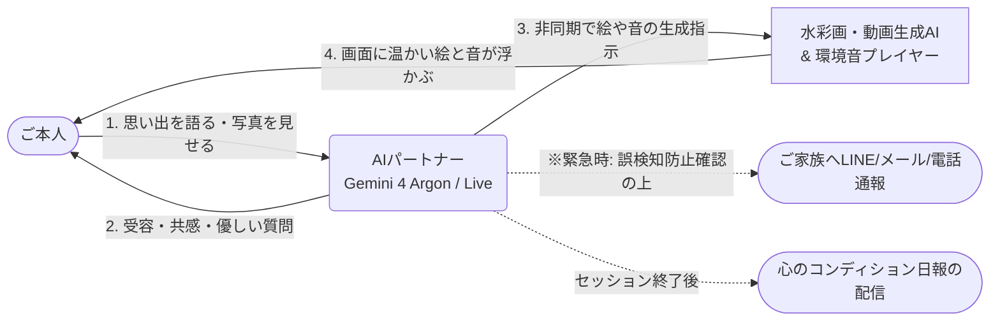

### 1.2 背景と解決する課題

超高齢社会において認知症およびMCI（軽度認知障害）の予防・ケアの重要性が叫ばれる一方、介護現場や在宅には以下の深刻な課題が存在します。

| 課題領域 | 現状の課題と限界 | 本システム（おもいでキャンバス v2.0）による解決策 |
| :--- | :--- | :--- |
| **① 介護者・家族の傾聴疲労** | 同じ話を何度も否定せずに傾聴し、ゆっくりとしたペースに合わせ続けることは、家族や職員にとって多大な時間的・精神的疲労を伴う。 | **AIによる無制限の受容的傾聴**<br>Gemini Liveにより、24時間何度でも「初めて聞くように新鮮に驚き、絶対に否定せず、相手のペースに合わせる」理想の対話パートナーを提供。 |
| **② 従来の回想法の限界** | 写真を用いた回想法は有効だが、「昔の写真が手元にない」「頭の中にしかない記憶や未来の夢は写真化できない」という限界がある。 | **「言葉」から「視覚・聴覚」へのリアルタイム生成**<br>対話中の情景をAIが抽出し、その場で「温かい水彩画」「穏やかな映像」「懐かしい環境音」を生成。記憶の連鎖を加速。 |
| **③ 一般的AIチャットの不適合** | 通常のAIは「長文で答える」「事実の誤認を正論で訂正する」「一度に複数の質問をする」ため、認知症患者を混乱・疲弊させる。 | **進行度別パーソナライズ制御**<br>MCI／軽度／中等度のレベルに応じ、発話文字数・質問形式・画風を医学的知見に基づき動的ルーティング。 |
| **④ 一人対話時の急変・孤立リスク** | タブレット前での一人対話中、体調急変や強い不安に気づけないリスクがある。 | **カメラ見守り ＆ 二段階確認付きSOS通報**<br>1FPSカメラで見守りつつ、SOS検知時は誤作動を防ぐ確認を経てご家族へ即座に通報。 |

### 1.3 4つの臨床アプローチ（非薬物療法）

本システムは、認知症ケア・老年心理学で実証されている以下の4大非薬物療法をコアロジックとしてシステムプロンプトおよび機能へ完全統合しています。

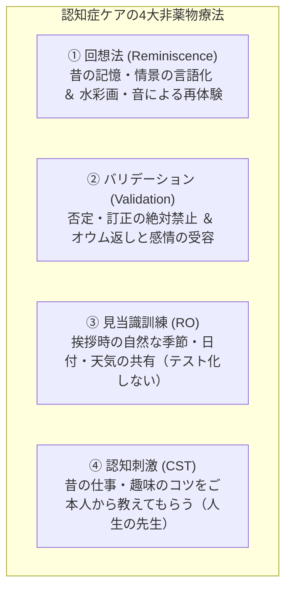

### 1.4 システムコンセプトと価値提供サイクル

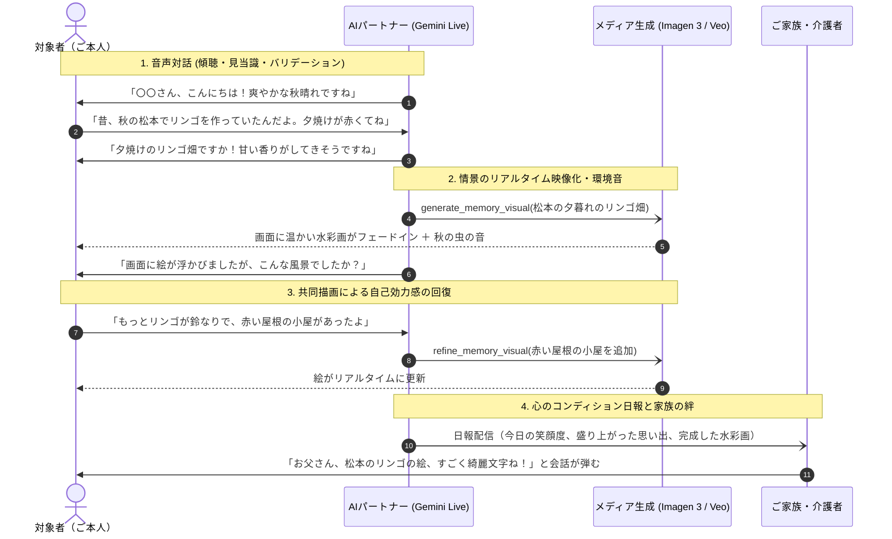

---

## 2. 要件定義（Requirements Definition）

### 2.1 ユーザーロールとユースケース

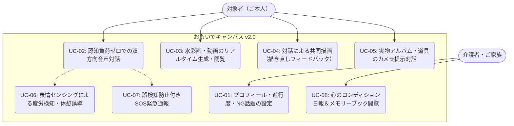

### 2.2 機能要件一覧（Functional Requirements）

| 要件ID | カテゴリ | 機能名 | 機能詳細 | 優先度 |
| :--- | :--- | :--- | :--- | :---: |
| **FR-01** | 設定管理 | プロフィール・進行度設定 | 呼称、年代、進行度（MCI／軽度／中等度）、元職、趣味、ゆかりの地、トリガーワード、NG話題、緊急連絡先の登録・編集。 | 高 |
| **FR-02** | プロンプト | 動的システムプロンプト構築 | FR-01の設定および進行度マトリクスに基づき、発話長・質問形式・態度を定めた `system_instruction` を動的に生成。 | 高 |
| **FR-03** | 音声対話 | フルデュプレックス双方向音声通信 | Gemini Live APIを用い、低遅延（PCM 16/24kHz）かつ相槌や発話の割り込み（Barge-in）に自然に対応する音声対話。 | 高 |
| **FR-04** | 視覚化 | 情景抽出＆非同期メディア生成 | 対話から情景（場所・季節・色など）を抽出し、裏側でImagen 3（水彩画）またはVeo（穏やかな動画）を非同期生成。 | 高 |
| **FR-05** | 安全制御 | 医療安全プロンプトラッパー | テレビサイン（幻覚）防止のため、実写人物の顔生成を遮断し、「水彩画・絵本風」「人物は後ろ姿/シルエット」を強制。 | 高 |
| **FR-06** | 共同描画 | 段階的共同描画・描き直し | 完成した絵に対して「もっと屋根は赤かった」等のフィードバックを受け、修正版を再生成・提示（自己効力感の向上）。 | 高 |
| **FR-07** | 五感刺激 | 懐かしの環境音再生 | 情景に合わせて「風鈴」「波」「虫の声」「電車の音」「祭りの囃子」等の穏やかな環境音（BGM）を自動連動再生。 | 中 |
| **FR-08** | 見守り | 表情・疲労認識 ＆ 実物認識 | タブレット内蔵カメラ（1FPS）で表情（笑顔・困惑・あくび）を検知し対話を調整。また手元の写真や道具の提示を認識。 | 高 |
| **FR-09** | 安全機構 | 誤検知防止付きSOS緊急通報 | 「助けて」「苦しい」等の発話を検知時、文脈判定と二段階確認を経て、メール・LINE・電話（Twilio）で家族へ即時通報。 | 高 |
| **FR-10** | セッション | 疲労防止タイマー制御 | 1セッション10〜15分を目安とし、時間経過または疲労検知時にAIが「お茶にしましょうか」と自然に会話を終了誘導。 | 高 |
| **FR-11** | 記録・共有 | 心のコンディション日報 ＆ メモリーブック | セッション終了後、笑顔度や盛り上がった話題、生成された絵をまとめた「心のコンディション日報」を自動作成・家族へ共有。 | 中 |

### 2.3 非機能要件（Non-Functional Requirements）

| 要件ID | 項目 | 要件仕様 |
| :--- | :--- | :--- |
| **NFR-01** | **UI/UX（認知負荷ゼロ）** | ご本人用画面にはボタン・メニュー・文字入力を一切配置しない。左側に「AIアバター」、右側に「特大キャンバス」のみを配置。 |
| **NFR-02** | **医療・心理上の安全性** | 幻覚・妄想（テレビサイン）防止のため、中等度以上ではリアルな実写人物をシステムレベルで遮断。アバターも不気味の谷を避けイラスト調を採用。 |
| **NFR-03** | **非同期応答性** | 画像生成（数秒〜十数秒）の実行中も、Gemini Liveの音声ストリームを一切途切れさせず、裏側で生成し完了次第クロスフェード表示。 |
| **NFR-04** | **プライバシー・個人情報保護** | 個人プロフィールや対話ログ、撮影されたカメラ映像（一時フレーム）は外部学習に利用させず、ローカルでセキュアに管理。 |
| **NFR-05** | **緊急通報の信頼性** | 単語マッチングだけでなくLLMによる文脈判断 ＋ 二段階の本人確認を挟み、昔話やドラマの話題による暴発（誤通報）を防止。 |

---

## 3. 基本設計・システムアーキテクチャ（Basic Design）

### 3.1 システム全体構成図

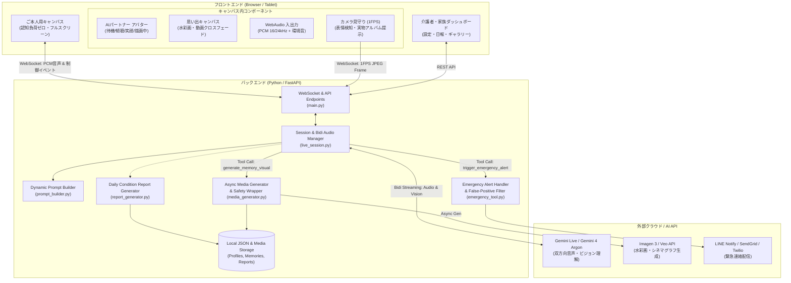

### 3.2 フロントエンド画面設計

#### ① ご本人用「認知負荷ゼロ」フルスクリーン画面
画面内に不要なボタンやスクロールバーを排除し、高齢者が戸惑わない構成とします。

```text
+-----------------------------------------------------------------------------------+
|  [ おもいでキャンバス ]                                                            |
+-------------------------------------------------+---------------------------------+
|                                                 |                                 |
|            【AIパートナー アバター】             |        【思い出キャンバス】       |
|                                                 |                                 |
|                     ( ^_^ )                     |     +---------------------+     |
|                      / | \                      |     |                     |     |
|                       / \                       |     |     温かい水彩画     |     |
|                                                 |     |    (またはシネマグラフ)    |     |
|          ・待機中：優しく微笑む                   |     |                     |     |
|          ・傾聴中：頷きながら耳を傾ける           |     +---------------------+     |
|          ・発話中：口を動かし笑顔                 |   「夕暮れの松本とりんご畑」       |
|          ・描画中：スケッチブックに描く姿         |                                 |
|                                                 |   ♪ 環境音（虫の声・風の音）     |
|                                                 |                                 |
+-------------------------------------------------+---------------------------------+
|  ● お話を聞いています...（特大ステータスバー・穏やかな波形アニメーション）           |
+-----------------------------------------------------------------------------------+
```

#### ② 介護者・ご家族用ダッシュボード（設定 ＆ 日報）
- **プロフィール設定タブ**：呼称、年代、進行度、昔の仕事、趣味、ゆかりの地、NG話題、緊急連絡先（LINE/電話/メール）の設定。
- **メモリーブック・日報タブ**：過去に生成された絵画の一覧と、セッションごとの「心のコンディション日報（笑顔の時間、語られた思い出、対話ハイライト）」の閲覧・PDF出力。

### 3.3 バックエンドサーバー詳細仕様 ＆ 公開ホスティング構成

#### 3.3.1 バックエンドサーバーの役割と必須性
本システムでは、以下の理由から**堅牢なバックエンドサーバー（Python / FastAPI）が必須**となります。ブラウザ単体（フロントエンドのみ）ではセキュアかつ安定した動作を実現できません。

1. **秘密情報（APIキー等）の絶対保護**：
   - Gemini Live API、Imagen 3 / Veo、LINE/Twilio などの認証キー・トークンをブラウザ側に露出させず、サーバー環境変数（`.env` または Cloud Secret Manager）で厳重に秘匿管理。
2. **リアルタイム音声・映像ストリームの中継プロキシ**：
   - ブラウザの WebAudio（PCM 16kHz）およびカメラ（1FPS画像）を安全に受け、Gemini Live API（双方向WebSocket / gRPC）へ低遅延中継。
   - Geminiからの合成音声（PCM 24kHz）をリアルタイムにデコードしてブラウザへ配信。
3. **対話を止めない非同期メディア生成（Asyncio Task）**：
   - 会話中に発火する重い画像・動画生成処理（数秒〜十数秒）をバックグラウンドタスクとして非同期実行し、Gemini Liveとの音声対話ストリームを絶対にブロック・中断させない。
4. **医療安全ガードレール＆誤検知防止フィルタ**：
   - プロンプトラッパーによる実写人物の排除や、SOS発話時の二段階確認判定をサーバー側で厳格に判定・制御。
5. **外部緊急連絡・日報生成の永続化**：
   - LINE / Twilio（電話自動架電） / SendGrid（メール）の一斉発信、およびセッションログから「心のコンディション日報」を自動生成・ローカル/DBへの安全保存。

---

#### 3.3.2 REST API エンドポイント仕様

FastAPIにより、介護者用ダッシュボードおよびフロントエンド初期化用のREST APIを提供します。

| メソッド | パス | 説明 | リクエスト形式 | レスポンス形式 |
| :--- | :--- | :--- | :--- | :--- |
| `GET` | `/api/health` | サーバー死活監視・API接続確認 | なし | `{"status": "ok", "gemini_connected": true}` |
| `GET` | `/api/profile` | 現在の対象者プロフィール取得 | なし | `UserProfile` (JSON) |
| `POST` | `/api/profile` | プロフィール・進行度・連絡先更新 | `UserProfile` (JSON) | `{"status": "saved", "user_id": "..."}` |
| `GET` | `/api/memories` | 生成された思い出絵画・動画一覧 | クエリ: `?limit=20` | `List[MemoryArtifact]` (JSON) |
| `GET` | `/api/reports` | 心のコンディション日報一覧取得 | クエリ: `?date=YYYY-MM-DD` | `List[DailyConditionReport]` (JSON) |
| `POST` | `/api/emergency/test` | 緊急通報のテスト発信（疎通確認） | `{"channel": "line|phone|email"}` | `{"status": "dispatched"}` |

---

#### 3.3.3 WebSocket リアルタイム通信プロトコル仕様 (`/ws/live`)

本人用キャンバス画面との間で、フルデュプレックス（全二重）の双方向通信を行います。

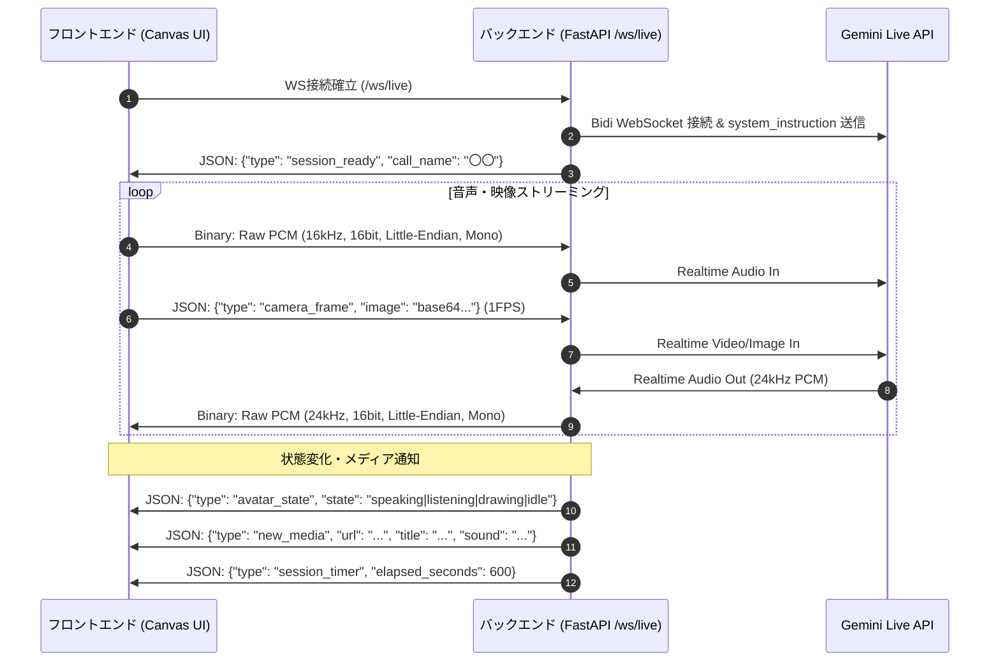

- **クライアント $\rightarrow$ サーバー送信フォーマット**：
  - **バイナリフレーム**：マイクからキャプチャした生のPCMデータ（16,000Hz, 16-bit, Little-Endian, モノラル）。
  - **テキスト/JSONフレーム**：
    - `{"type": "camera_frame", "data": "data:image/jpeg;base64,..."}`：1秒ごとのWebRTCカメラ映像。
    - `{"type": "start_session"}` / `{"type": "end_session"}`：対話開始/終了トリガー。
- **サーバー $\rightarrow$ クライアント送信フォーマット**：
  - **バイナリフレーム**：Geminiから届いた合成音声PCMデータ（24,000Hz, 16-bit, Little-Endian, モノラル）。WebAudioで即時バッファ再生。
  - **テキスト/JSONフレーム**：
    - `{"type": "avatar_state", "state": "idle" | "listening" | "speaking" | "drawing"}`：アバター表情切り替え。
    - `{"type": "new_media", "media_url": "...", "title": "...", "ambient_sound": "..."}`：生成された絵画/動画の表示指示。
    - `{"type": "emergency_alert", "status": "dispatched"}`：SOS通報実行通知。

---

#### 3.3.4 バックグラウンド非同期タスク ＆ セッション管理
- **非同期タスク分離**：
  FastAPIの `asyncio.create_task()` を用い、メディア生成（`media_generator.py`）や外部通報（`emergency_tool.py`）はメインのWebSocketループと完全に独立したバックグラウンドタスクとして実行。生成中にGemini Liveの音声が途切れることは構造上ありません。
- **タイムアウト・切断ハンドリング**：
  回線切断時は3回まで自動再接続を試行。セッション開始から12分経過時に内部イベントを発行し、AIへ「そろそろ温かいお茶にしましょうか」という自然な終了発話を指示。

---

#### 3.3.5 無料バックエンドサーバー確保 ＆ 公開ホスティング構成

本システムは、**本番実装・デプロイ先として「① Google Cloud Run（公式常時無料枠）」を採用**します。
ただし、開発段階の利便性やクレジットカード登録の要否に応じて、以下の**3つの完全無料（0円）確保ルート**を柔軟に選択・切り替え可能な設計とします。

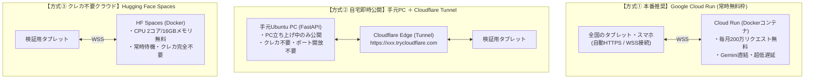

##### 3大無料ホスティング方式の比較一覧

| 方式名 | 費用 | クレジットカード | WebSocket対応 | 特徴・メリット | 注意点・制約 |
| :--- | :---: | :---: | :---: | :--- | :--- |
| **① Google Cloud Run**<br>（★本番採用） | **実質0円**<br>(Always Free枠内) | 必要<br>(枠内なら請求0円) | **◎ 完全対応**<br>(最大60分ストリーム) | ・**Gemini Live / Vertex AI 直結で音声遅延が最短**<br>・毎月200万リクエスト / 36万vCPU秒が恒久無料<br>・アクセスがない時はインスタンス0台で待機（無料枠を温存）<br>・カスタムドメイン＆自動HTTPS/WSS | クレジットカード登録が必要 |
| **② 手元PC ＋ Cloudflare Tunnel**<br>（開発・即時検証） | **完全0円** | **不要** | **◎ 完全対応** | ・手元のUbuntu PCを即座に世界中へ安全公開<br>・ルーター設定や固定IP不要、1コマンドでURL発行<br>・無料の暗号化URL（`https://*.trycloudflare.com`） | 手元PCを起動中のみアクセス可能 |
| **③ Hugging Face Spaces**<br>（完全無料クラウド） | **完全0円** | **不要** | **○ 対応** | ・クレジットカード一切不要でクラウド常時稼働<br>・Dockerコンテナが無料（CPU 2コア / RAM 16GB）<br>・GitHubライクにコードプッシュするだけで自動デプロイ | 48時間アクセスがないとスリープ（初回起動に15秒程度） |

---

##### 各方式のデプロイ・起動仕様

###### 【方式①：Google Cloud Run へのデプロイ手順（本番）】
プロジェクトルートに `Dockerfile` を配置し、Google Cloud CLI (`gcloud`) で1コマンドデプロイします。

```dockerfile
# Dockerfile（Cloud Run用軽量コンテナ）
FROM python:3.12-slim
WORKDIR /app
COPY requirements.txt .
RUN pip install --no-cache-dir -r requirements.txt
COPY . .
ENV PORT=8080
CMD exec uvicorn backend.main:app --host 0.0.0.0 --port ${PORT}
```

```bash
# デプロイコマンド（CPU常に割り当て無効＝ゼロスケールで無料枠を最大活用）
gcloud run deploy omoide-canvas \
  --source . \
  --platform managed \
  --region asia-northeast1 \
  --allow-unauthenticated \
  --set-env-vars GEMINI_API_KEY="your_api_key" \
  --session-affinity
```

###### 【方式②：Cloudflare Tunnel による手元PC公開手順（即時テスト）】
手元のUbuntu PCでFastAPIを起動したまま、別ターミナルで `cloudflared` を実行するだけで、固定IPやルーター開放不要で外部URLが発行されます。

```bash
# 1. バックエンド起動
source .venv/bin/activate
uvicorn backend.main:app --host 0.0.0.0 --port 8000

# 2. 別ターミナルでTunnel起動（無料・クレカ不要）
npx untun@latest tunnel http://localhost:8000
# または: cloudflared tunnel --url http://localhost:8000
# -> 発行された https://xxxx.trycloudflare.com をスマホやタブレットで開くだけで即利用可能
```

###### 【方式③：Hugging Face Spaces へのデプロイ手順（クレカ不要クラウド）】
1. Hugging Face（無料アカウント）で「New Space」を作成（SDK: Docker を選択）。
2. リポジトリの Settings > Variables and secrets に `GEMINI_API_KEY` を登録。
3. `git push` でリポジトリをアップロードすれば、世界中からアクセス可能なHTTPS URLが常時稼働します。

---

### 3.4 非同期対話・画像生成・環境音シーケンス（会話を止めない設計）

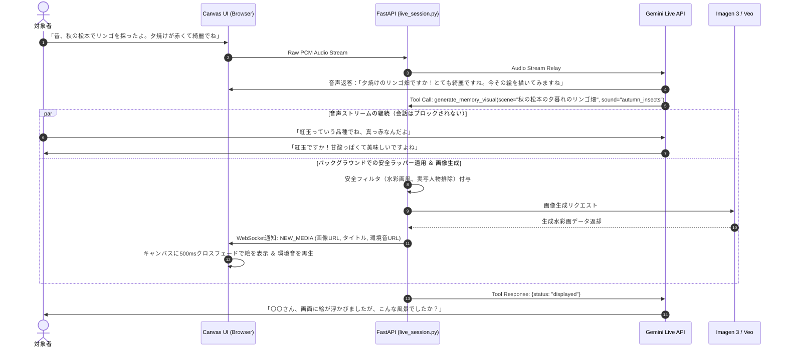

### 3.5 カメラ見守り＆表情・疲労フィードバックシーケンス

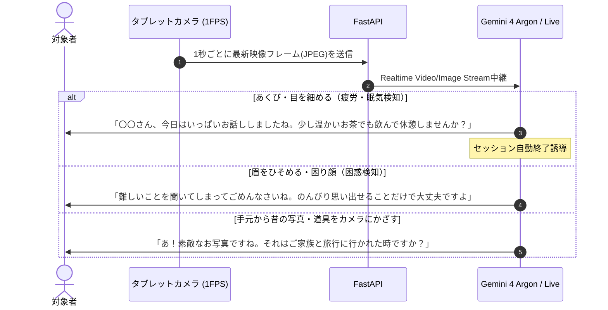

### 3.6 誤検知防止付きSOS緊急通報シーケンス

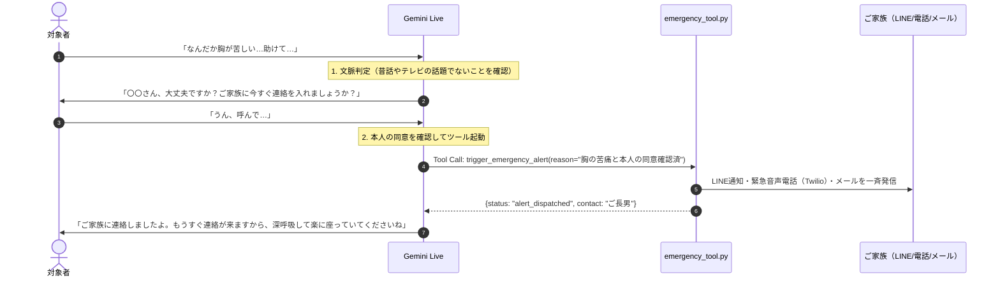

### 3.7 データモデル設計（ER図・クラス構成）

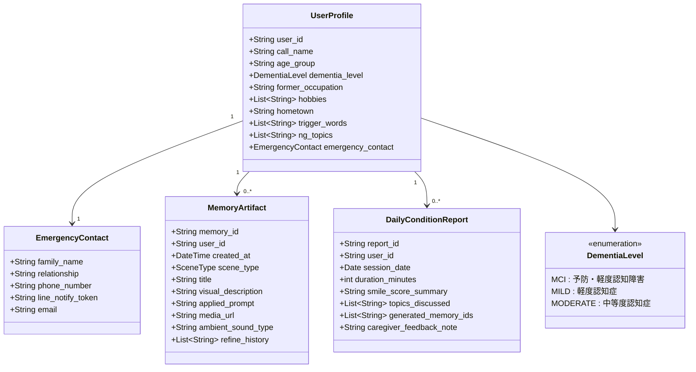

---

## 4. 詳細仕様書（Detailed Specifications）

### 4.1 進行度レベル別・対話＆ビジュアル制御マトリクス

`prompt_builder.py` が `UserProfile.dementia_level` に応じて切り替える厳密な対話・ビジュアル制御表です。

| 制御項目 | `mci`（予防・軽度認知障害） | `mild`（軽度認知症） | `moderate`（中等度認知症） |
| :--- | :--- | :--- | :--- |
| **主目的** | 前頭葉活性化・語彙の引き出し・生活意欲向上 | 長期記憶の賦活・自尊心維持・失敗体験の回避 | 感情の安定（安心感）・BPSD予防・五感の共有 |
| **1ターンの発話長** | **2〜3文（60〜80文字目安）**<br>自然でテンポの良い会話 | **1〜2文（40〜50文字以内）**<br>ゆっくり、わかりやすい単文 | **1文のみ（20〜30文字以内）**<br>極めてシンプルで穏やかな声かけ |
| **質問の形式** | **オープンクエスチョン中心**<br>「どうやって作るんですか？」「どんなところが好きでしたか？」と段取りや理由を尋ねる。 | **ヒント提示 ＋ 二択質問**<br>「美空ひばりさんと石原裕次郎さんなら、どちらが好きでしたか？」と選択肢を提示。 | **Yes/No または感覚の共有のみ**<br>「なぜ」「どうやって」は禁止。8割を「オウム返し＋共感」にし、質問は最小限。 |
| **臨床手法** | 回想法 ＋ 認知刺激療法（連想・料理手順） | 回想法 ＋ リアリティ・オリエンテーション | バリデーション的傾聴（感情への共感） |
| **生成ビジュアル** | ノスタルジックな絵画調、昭和レトロ写真風 | **温かい水彩画風・色鉛筆画風**<br>（人物の顔は抽象化） | **やさしい絵本風・ちぎり絵風（厳守）**<br>（実写・リアルな人物は完全排除） |
| **アバター動作** | 標準（うなずき・笑顔） | ゆっくりとした動き、明確な口の動き | 大きな笑顔、穏やかで安心感のある表情変化 |

---

### 4.2 動的システムプロンプト・テンプレート仕様

`backend/prompt_builder.py` で組み立てるプロンプト構造です。

```text
# 役割と基本スタンス
あなたは、高齢者の認知機能維持と心の安らぎを支える、温かくて聞き上手な対話パートナーです。
相手を「人生の大先輩」「先生」として深く敬い、以下のプロフィールとルールを厳密に守って対話してください。

# 【対象者プロフィール】
・お名前（呼び方）：{call_name} さん
・年代：{age_group}
・昔の仕事・得意分野：{former_occupation}
・好きなこと・趣味：{hobbies}
・ゆかりの土地（故郷）：{hometown}
・思い出のキーワード（自然に話題に混ぜる）：{trigger_words}
・絶対に触れてはいけないNG話題：{ng_topics}

# 【全レベル共通の絶対原則（医療・安全基準）】
1. 否定・訂正の絶対禁止：
   事実と異なる発言や同じ話の繰り返しがあっても、決して指摘・訂正してはなりません。毎回「初めて聞くように」新鮮な驚きと関心を示してください。
2. 短期記憶テストの禁止：
   「昨日何を食べましたか」「さっき話した人の名前は？」など、直近の記憶を試す質問は絶対にしないでください。
3. 質問は1ターンに最大1つまで：
   複数の質問を同時に投げて相手を混乱させないでください。
4. 人生の先生として教えを乞う姿勢：
   「私は詳しくないので、ぜひ{call_name}さんに教えていただきたいです」というスタンスを貫いてください。
5. 見当識の自然な共有：
   セッション冒頭は「今日は秋晴れで気持ちいいですね」「もう10月も後半ですね」と、自然に季節や日付を織り交ぜて挨拶してください。

# 【進行度別ルール（level: {dementia_level}）】
{level_specific_rules}

# 【思い出の映像化・ツール呼び出し指示】
会話の中で昔の思い出の風景や、これからの夢について、場所・季節・色・情景が語られたら：
1. まず「とても素敵な風景ですね！今その絵を描いてみますね」と声かけをする。
2. `generate_memory_visual` ツールを呼び出す。
3. 絵が表示されたら「〇〇さん、こんな雰囲気でしたか？」と確認し、もし「もっと屋根は青かったよ」などと修正を言われたら `refine_memory_visual` を呼び出す。

# 【緊急通報（SOS）の絶対ルール】
相手が「助けて」「苦しい」「痛い」等を発した場合は、直ちにツールを呼ぶのではなく、まず「〇〇さん、大丈夫ですか？ご家族に連絡を入れましょうか？」と優しく確認してください。本人が同意（「呼んで」「お願い」等）した場合のみ、`trigger_emergency_alert` を呼び出してください。
```

---

### 4.3 Function Calling（ツール定義）詳細仕様

#### ① `generate_memory_visual`（情景抽出・メディア生成）
```json
{
  "name": "generate_memory_visual",
  "description": "対象者が語った思い出や夢の情景を、水彩画または穏やかな動画として描画・画面表示する",
  "parameters": {
    "type": "object",
    "properties": {
      "scene_type": {
        "type": "string",
        "enum": ["past_memory", "future_dream"],
        "description": "過去の思い出か、未来の夢・行きたい場所か"
      },
      "japanese_title": {
        "type": "string",
        "description": "画面に表示する情緒的な短いタイトル（例：夕暮れの松本とリンゴ畑）"
      },
      "visual_elements": {
        "type": "string",
        "description": "場所、季節、時間帯、色彩、象徴的なモチーフ等の情景描写（英語または日本語）"
      },
      "media_format": {
        "type": "string",
        "enum": ["image", "video"],
        "description": "通常はimage。波や風の揺れなど穏やかな微細動が効果的な場合のみvideo"
      },
      "ambient_sound": {
        "type": "string",
        "enum": ["autumn_insects", "gentle_waves", "wind_chime", "festival_music", "train_steam", "birds_forest", "none"],
        "description": "情景に寄り添う環境音の種類"
      }
    },
    "required": ["scene_type", "japanese_title", "visual_elements", "media_format"]
  }
}
```

#### ② `refine_memory_visual`（段階的共同描画・修正）
```json
{
  "name": "refine_memory_visual",
  "description": "生成された絵に対する対象者の感想（修正希望）を反映して絵を再描画する",
  "parameters": {
    "type": "object",
    "properties": {
      "original_memory_id": {
        "type": "string",
        "description": "修正元の思い出ID"
      },
      "user_feedback": {
        "type": "string",
        "description": "対象者の修正希望発言（例：屋根は赤じゃなくて青かった、もっと犬を大きくして）"
      },
      "updated_visual_elements": {
        "type": "string",
        "description": "フィードバックを反映した更新後の情景描写プロンプト"
      }
    },
    "required": ["original_memory_id", "user_feedback", "updated_visual_elements"]
  }
}
```

#### ③ `trigger_emergency_alert`（二段階確認済みSOS通報）
```json
{
  "name": "trigger_emergency_alert",
  "description": "対象者の体調急変やSOSについて本人確認が取れた際、ご家族・介護者へ一斉通知を発信する",
  "parameters": {
    "type": "object",
    "properties": {
      "urgency_level": {
        "type": "string",
        "enum": ["high_physical_distress", "anxiety_call_family"],
        "description": "身体的苦痛か、強い不安による家族呼び出しか"
      },
      "user_utterance": {
        "type": "string",
        "description": "本人が発したSOSの内容"
      },
      "confirmation_obtained": {
        "type": "boolean",
        "description": "本人へ『ご家族に連絡しましょうか？』と確認し承諾を得たか（True必須）"
      }
    },
    "required": ["urgency_level", "user_utterance", "confirmation_obtained"]
  }
}
```

---

### 4.4 画像・動画生成プロンプトの安全変換フィルタ（Safety Wrapper）

医療・ケア安全基準（テレビサイン・幻覚の防止）を遵守するため、バックエンドの `media_generator.py` で以下の数式・ルールによるプロンプト変換をシステムレベルで強制適用します。

$$\text{Final Prompt} = P_{\text{style}}(\text{level}) + P_{\text{era}}(\text{scene\_type}) + \text{visual\_elements} + P_{\text{safety\_negative}}$$

1. **$P_{\text{style}}(\text{level})$（画風プレフィックス）**：
   - `mild` / `moderate`: `"A warm, nostalgic, gentle watercolor and colored pencil storybook illustration, soft pastel tones, cozy lighting. "`
   - `mci`: `"A gentle, nostalgic retro fine-art painting style, soft warm colors. "`
2. **$P_{\text{era}}(\text{scene\_type})$（時代背景）**：
   - `past_memory`: `"Set in nostalgic 1950s-1970s Showa-era Japan. "`
   - `future_dream`: `"A peaceful, dreamy, and bright atmosphere. "`
3. **$P_{\text{safety\_negative}}$（安全制約サフィックス）**：
   - **全メディア共通**：`"Do NOT render photorealistic human faces. Depict any human figures strictly from behind, at a far distance, or as soft storybook silhouettes. No modern skyscrapers, no smartphones, no dark scary shadows, no sharp contrasts, no text or watermarks."`
   - **動画（`video` / Veo）追加制約**：`"Fixed static tripod camera shot, cinemagraph style, peaceful and extremely subtle slow-motion movements (e.g. gentle breeze through tree leaves, soft ripples on a pond). No camera zoom, no panning, no fast motions."`

---

### 4.5 AIパートナー表情アバター状態遷移仕様

画面左側のAIパートナーは、不気味の谷を避けるため親しみやすいイラストアバターを採用し、対話状態に応じて4つの表情を滑らかに切り替えます。

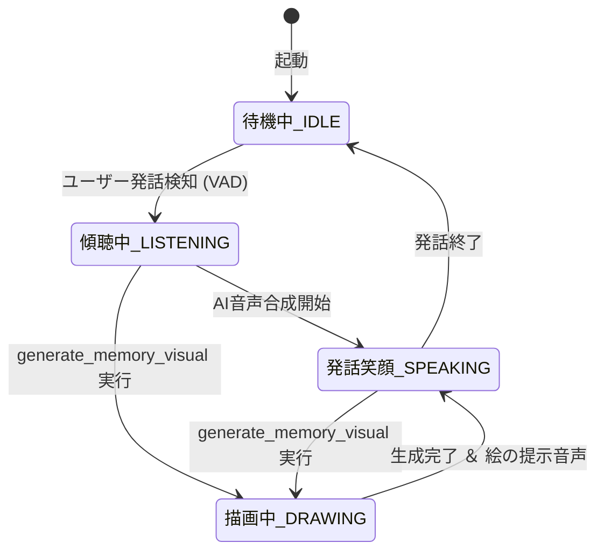

- **IDLE（待機中）**：穏やかに目を開け、時折まばたきをしながら優しく微笑む。
- **LISTENING（傾聴中）**：体をわずかに前に乗り出し、小さく頷きながら「聞いています」のポーズ。
- **SPEAKING（発話笑顔）**：口が音声の音量に合わせて穏やかに開閉し、目元が三日月型に笑う。
- **DRAWING（お絵描き中）**：小さなスケッチブックに筆を走らせている愛らしいイラストに切り替わり、生成待ち時間の退屈や不安を防止。

---

### 4.6 カメラセンシング（表情・疲労・実物認識）仕様

タブレット前面カメラから **1FPS（1秒に1フレーム、JPEG低容量圧縮）** でバックエンドへ画像を送信し、Geminiのマルチモーダル機能で分析します。

1. **表情＆疲労モニタリング**：
   - **困惑検知**（眉をひそめる、首を傾げる）：質問のレベルを自動で下げ、Yes/No形式や共感の復唱に切り替える。
   - **疲労・眠気検知**（あくび、目を閉じる時間が長い）：会話を自然に締めくくり、「お茶にしましょうか」とセッション終了を促す。
2. **実物アルバム・道具のカメラ認識**：
   - ご本人が手元の古い写真や思い出の品（万年筆、編み物、茶道具など）をカメラにかざした際、「素敵な写真ですね！」「それは大切にされていたお道具ですか？」と自律的に視覚的対話を開始。

---

## 5. 理論的背景・臨床エビデンス（Clinical Evidence）

### 5.1 回想法（Reminiscence Therapy）
- **提唱者**：ロバート・バトラー（Robert Butler, 1963）
- **メカニズム**：アルツハイマー病などの認知症では、海馬を中心とした「近時記憶（新しい記憶）」から順に障害されますが、若い頃の「遠隔記憶（長期記憶）」や手続き記憶は比較的保たれます。昔の写真や情景をトリガーに過去の肯定的な思い出を語り合うことで、脳血流量が増加し、精神的安定、うつ気分の改善、自尊心（アイデンティティ）の回復がもたらされます。

### 5.2 バリデーション療法（Validation Therapy）
- **提唱者**：ナオミ・フェイル（Naomi Feil）
- **メカニズム**：見当識障害のある認知症患者に対し、「今日は令和ですよ」「そんな人はいません」と現実を突きつけて訂正することは、患者に深い屈辱感、恐怖、怒り（BPSD）を引き起こします。事実の正誤ではなく、「その人が感じている感情・主観的世界」をそのまま受容し、**重要な言葉の復唱（Rephrasing）**によって「私は受け入れられている」という安心感を与えます。

### 5.3 見当識訓練（Reality Orientation: RO）
- **概要**：日付、季節、天候、場所などの見当識を維持・刺激する訓練。
- **本システムでの工夫**：「今日は何日ですか？」といったテスト（試験）形式ではなく、「今日は爽やかな秋晴れですね」「10月もあっという間ですね」と、日常会話の心地よい挨拶の中に自然に織り交ぜることで、自尊心を傷つけずに時間・季節の感覚を刺激します。

### 5.4 認知刺激療法（Cognitive Stimulation Therapy: CST）
- **概要**：英国NICEガイドライン等でも推奨される非薬物介入法。「昔の郷土料理の味付けのコツ」「大工仕事の道具の扱い方」などをご本人から教わることで、言語機能や前頭葉の実行機能、語彙想起を賦活します。

### 5.5 医療安全：テレビサイン（TV Sign）対策
- **医学的背景**：中等度以上の認知症では、テレビや画面の中の出来事を「現実の部屋の中で起きている」と誤認する「テレビサイン」と呼ばれる症状が知られています。
- **本システムの防護策**：画面にリアルな架空人物（実写風の顔）を表示すると、「見知らぬ他人が家に入ってきた」とパニックや物盗られ妄想に繋がる危険性があります。そのため、システムラッパーで実写の人物を遮断し、温かい「水彩画・絵本風」「人物は後ろ姿」に限定しています。

### 5.6 不気味の谷の回避（イラストアバターの必然性）
リアルすぎる3DCGや中途半端な実写アバターは、「不気味の谷（Uncanny Valley）」現象を引き起こし、高齢者に警戒心や不快感を与えます。あえてシンプルで温かみのある手描き調イラストアバターを採用することで、直感的で親しみやすい安心感を提供します。

---

## 6. 実装ディレクトリ構成と開発手順（Implementation Guide）

### 6.1 ディレクトリ構成

```text
omoide-canvas/
├── docs/
│   ├── specification.md       # 本ドキュメント（総合仕様書 v2.0 マスター）
│   ├── specification_v1_backup.md # 旧版バックアップ
│   ├── presentation_slides.html # スライド発表用HTML
│   └── overview_guide.md      # 概要解説ガイド
├── references/                # Obsidian Vault 連携シンボリックリンク
│   └── (USB_AI_DATA/Obsidian/Test_1/アプリ開発/omoide-canvas)
├── backend/
│   ├── main.py                # FastAPI メイン、WebSocket ルーティング、静的配信
│   ├── models.py              # Pydantic モデル (UserProfile, MemoryArtifact, Report)
│   ├── prompt_builder.py      # 進行度別動的システムプロンプト生成
│   ├── live_session.py        # Gemini Live API 双方向音声・ツール呼び出しセッション管理
│   ├── media_generator.py     # Imagen 3 / Veo 非同期生成 ＆ 安全ラッパー
│   ├── emergency_tool.py      # 二段階確認付きSOS通報・Twilio/LINE連携
│   └── report_generator.py    # 心のコンディション日報 自動生成
├── frontend/
│   ├── index.html             # メイン画面（ご本人用キャンバス ＆ 介護者設定切替）
│   ├── styles.css             # 認知負荷ゼロUIスタイル（アバター＋キャンバス配置）
│   ├── app.js                 # WebAudio PCM入出力、カメラキャプチャ、WebSocket制御
│   └── assets/
│       ├── avatars/           # アバター表情イラスト (idle, listening, speaking, drawing)
│       └── sounds/            # 懐かしの環境音音源 (autumn, waves, chimes, etc.)
├── static/
│   └── memories/              # 生成された水彩画・動画・日報のローカル保存先
├── requirements.txt           # 依存パッケージ定義
├── .env.example               # 環境変数テンプレート
├── .env                       # 環境変数設定ファイル（APIキー等）
└── .gitignore                 # Git除外設定
```

### 6.2 各モジュールの役割詳細

1. `backend/models.py`:
   - `UserProfile`, `DementiaLevel`, `MemoryArtifact`, `DailyConditionReport` などのデータクラス定義。
2. `backend/prompt_builder.py`:
   - 仕様書 4.1〜4.2 に基づき、進行度レベル・プロフィールから動的プロンプトを生成。
3. `backend/media_generator.py`:
   - 仕様書 4.4 の安全数式ラッパーを通し、Imagen 3 / Veo で画像を非同期生成（メインストリーム非停止）。
4. `backend/live_session.py`:
   - `google-genai` SDK を用い、Gemini Live API との音声/映像双方向通信、Tool Call（`generate_memory_visual`, `trigger_emergency_alert`）をハンドリング。
5. `backend/emergency_tool.py`:
   - SOS検知時の確認フラグ判定と、ご家族への外部通知（メール/LINE/電話）実行。
6. `frontend/app.js`:
   - WebAudio API（マイクPCM録音 16kHz/再生 24kHz）、WebRTCカメラ（1FPS画像送信）、WebSocketイベント購読。

### 6.3 開発・起動手順

```bash
# 1. 仮想環境の有効化
source .venv/bin/activate

# 2. 環境変数の設定 (.env に GEMINI_API_KEY を記入)
cp .env.example .env

# 3. サーバー起動
uvicorn backend.main:app --host 0.0.0.0 --port 8000 --reload

# 4. ブラウザでアクセス
# http://localhost:8000
```