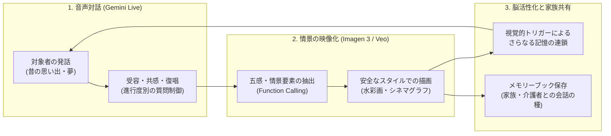
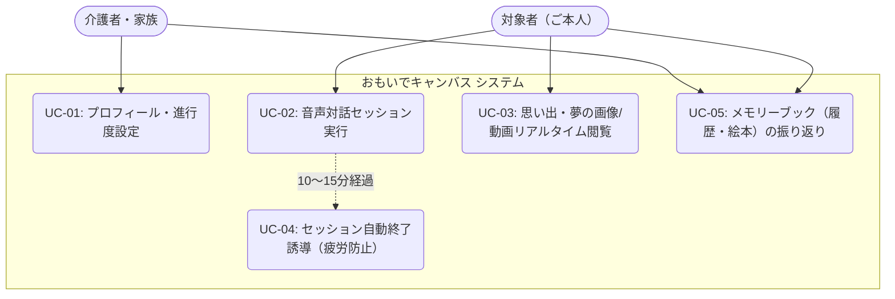
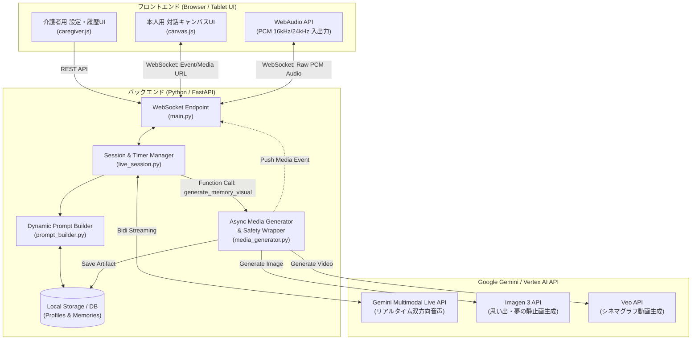
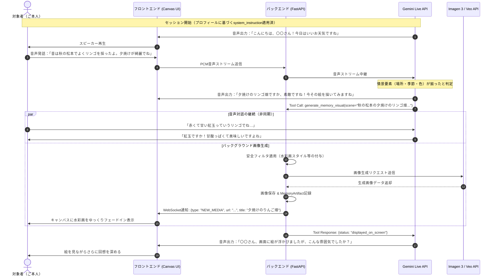
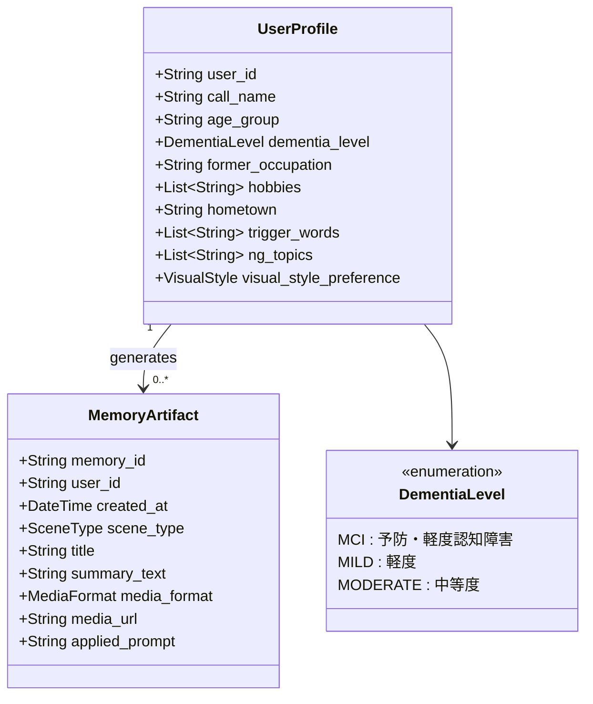
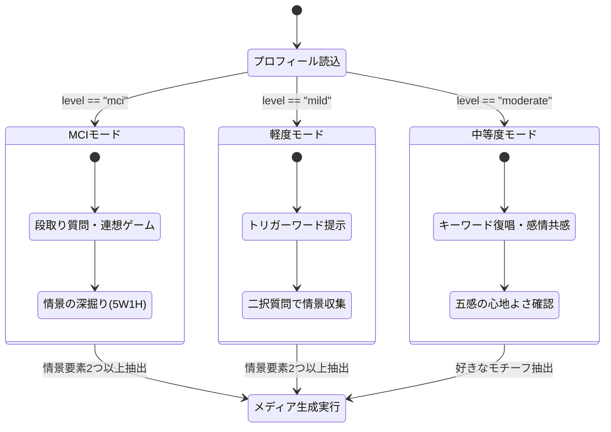

# プロジェクト総合仕様書：『おもいでキャンバス（仮）』
**〜 Gemini Live × 生成AIによる認知症予防・回想法対話システム 〜**

> [!abstract] ドキュメント概要
> 本ドキュメントは、双方向音声対話AI（Gemini Live API）と画像・動画生成AI（Imagen 3 / Veo）を組み合わせた、認知症予防・進行抑制・BPSD緩和のための対話システム『おもいでキャンバス』の企画・要件定義・基本設計・詳細仕様・理論的背景をまとめたマスタードキュメントです。

---

## 1. 企画書（Project Proposal）

### 1.1 背景と課題

高齢化に伴い認知症およびMCI（軽度認知障害）の人口が増加する中、進行抑制や周辺症状（BPSD）の緩和には「回想法」などの非薬物療法（心理社会的アプローチ）が有効とされています。しかし、現場や家庭には以下の課題が存在します。

| 課題領域 | 現状の課題と限界 | 本プロジェクトでの解決アプローチ |
| :--- | :--- | :--- |
| **1. 介護者・家族の負担** | 同じ話を何度も否定せずに傾聴し、ゆっくりとしたペースに合わせ続けることは、家族や介護職員にとって時間的・精神的な負担（介護疲労）が大きい。 | **AIによる無制限の受容的傾聴**<br>Gemini Liveを活用し、24時間いつでも「初めて聞くように新鮮に驚き、絶対に否定せず、相手のペースに合わせる」対話パートナーを提供する。 |
| **2. 従来の回想法の限界** | 写真を使った回想法は効果が高いが、「昔の写真が手元にない」「本人の頭の中にしかない思い出や、これからの夢・願望は映像化できない」という限界がある。 | **「言葉」から「視覚」へのリアルタイム生成**<br>対話の中で語られた情景をAIが抽出し、その場で「温かい水彩画」や「穏やかな動画」を生成。記憶の視覚化とさらなる対話の連鎖を生む。 |
| **3. 画一的なAI対話の危険性** | 一般的なAIチャットボットは「長文で話す」「事実誤認を訂正する」「一度に複数の質問をする」ため、認知症患者を混乱・疲弊させてしまう。 | **進行度別パーソナライズ制御**<br>対象者の進行度（MCI／軽度／中等度）とプロフィールを変数化し、文の長さ・質問形式・画風を医学的知見に基づき動的にルーティングする。 |

### 1.2 コンセプトと価値提供フロー



---

## 2. 要件定義書（Requirements Definition）

### 2.1 ユーザーロールとユースケース



### 2.2 機能要件（Functional Requirements）

| 要件ID | カテゴリ | 機能名 | 機能詳細 | 優先度 |
| :--- | :--- | :--- | :--- | :---: |
| **FR-01** | 設定管理 | プロフィール・進行度設定 | 対象者の呼称、年代、進行度レベル（MCI／軽度／中等度）、昔の仕事、趣味、出身地、トリガーワード、NG話題を登録・編集できる。 | 高 |
| **FR-02** | プロンプト生成 | 動的システムプロンプト構築 | FR-01の設定パラメータに基づき、発話文字数制限や質問ルールを組み込んだ `system_instruction` を動的に生成する。 | 高 |
| **FR-03** | 音声対話 | フルデュプレックス音声通信 | Gemini Live APIを用い、低遅延かつ相槌や発話の割り込み（Barge-in）に自然に対応する双方向音声対話を行う。 | 高 |
| **FR-04** | メディア生成 | 情景抽出＆非同期メディア生成 | 会話中に情景要素が揃った際、Function Callingで裏側で画像（Imagen 3）または動画（Veo）を生成し、キャンバスに表示する。 | 高 |
| **FR-05** | 安全制御 | 生成プロンプト安全ラッパー | 進行度に応じて、実写の人物生成をブロックし「水彩画・絵本風」や「スローモーション」を強制適用するフィルタを通す。 | 高 |
| **FR-06** | セッション管理 | 疲労防止タイマー制御 | 1セッション10〜15分を目安とし、時間経過時にAIへ「自然な会話の締めくくり（お茶の時間の提案など）」を促す内部通知を送る。 | 中 |
| **FR-07** | 記録・共有 | メモリーギャラリー保存 | 生成された画像・動画と、対話から要約されたエピソードタイトル・説明文を紐づけて保存し、絵本のように閲覧できる。 | 中 |

### 2.3 非機能要件（Non-Functional Requirements）

| 要件ID | 項目 | 要件内容 |
| :--- | :--- | :--- |
| **NFR-01** | **UI/UX（認知負荷ゼロ設計）** | 本人用画面にはメニューや複雑なボタンを一切配置しない。特大のキャンバス領域と、AIが聞いている・話していることが直感的にわかる穏やかな波形（またはアバター）のみを表示する。 |
| **NFR-02** | **医療・ケア上の安全性** | 幻覚・妄想（テレビサイン等）の誘発を防ぐため、中等度以上の設定ではフォトリアルな人物画像の出力をシステムレベルで遮断する。 |
| **NFR-03** | **非同期処理と応答性** | 画像・動画生成（数秒〜十数秒）の実行中も、Gemini Liveの音声ストリームをブロックせず、会話を継続しながら完了次第フェードイン表示する。 |
| **NFR-04** | **プライバシー保護** | 個人の経歴や家族構成などのプロフィール情報、および生成された思い出データはローカル環境またはセキュアな専用ストレージで管理する。 |

---

## 3. 基本設計書（Basic Design）

### 3.1 システムアーキテクチャ図

Antigravityで実装・デバッグが容易な、Python（FastAPI）バックエンドとWebフロントエンドのリアルタイム通信構成です。



### 3.2 対話と画像生成の非同期シーケンス図

会話のテンポを損なわずに裏側で情景を描画し、画面に提示して再び会話を広げるフローです。



### 3.3 データモデル設計（ER図・クラス構成）



---

## 4. 詳細仕様書（Detailed Specifications）

### 4.1 進行度レベル別・対話制御マトリクス

`prompt_builder.py` が `UserProfile.dementia_level` に応じて切り替える対話仕様の定義表です。

| 制御項目 | `mci`（予防・軽度認知障害） | `mild`（軽度認知症） | `moderate`（中等度認知症） |
| :--- | :--- | :--- | :--- |
| **主目的** | 前頭葉の活性化・語彙の引き出し・生活意欲向上 | 長期記憶の賦活・自尊心の維持・失敗体験の回避 | 感情の安定（安心感）・BPSD予防・五感の共有 |
| **1ターンの発話量** | **2〜3文（60〜80文字目安）**<br>自然でテンポの良い会話 | **1〜2文（40〜50文字以内）**<br>ゆっくり、わかりやすい単文 | **1文のみ（20〜30文字以内）**<br>極めてシンプルで穏やかな声かけ |
| **質問の形式** | **オープンクエスチョン中心**<br>「どうやって作るんですか？」「どんなところが好きですか？」と段取りや理由を尋ねる。 | **ヒント付き・選択式質問（二択）**<br>「美空ひばりさんと石原裕次郎さんなら、どちらをよく聴きましたか？」と固有名詞を補う。 | **Yes/No または感覚の共有のみ**<br>「なぜ・どうやって」は禁止。8割を「オウム返し（復唱）＋共感」にし、質問は最小化する。 |
| **取り入れる手法** | 回想法 ＋ 認知刺激療法（連想ゲーム・季節の話題） | 回想法 ＋ リアリティ・オリエンテーション | バリデーション的傾聴（感情への共感） |
| **生成画像の画風** | ノスタルジックな絵画調、または昭和レトロ写真風 | **温かい水彩画風・色鉛筆画風**<br>（人物の顔は抽象化） | **やさしい絵本風・ちぎり絵風（厳守）**<br>（実写表現・リアルな人物は完全排除） |



---

### 4.2 動的システムプロンプト・テンプレート仕様

バックエンドで動的に変数を埋め込むベースプロンプトの仕様です。

> [!info] システムプロンプト構造（`prompt_builder.py` に実装）
> ```text
> # 役割
> あなたは、高齢者の認知機能維持と精神的安定をサポートする、優しくて聞き上手な対話パートナーです。
> 以下の【対象者プロフィール】と【進行度別ルール】を厳密に守って音声対話を行ってください。
>
> # 【対象者プロフィール】
> ・呼び方：{call_name}
> ・年代：{age_group}
> ・昔の仕事・得意だったこと：{former_occupation}
> ・好きなこと・趣味：{hobbies}
> ・ゆかりの場所：{hometown}
> ・思い出のキーワード（会話に自然に混ぜる）：{trigger_words}
> ・絶対に触れてはいけないNG話題：{ng_topics}
>
> # 【共通の絶対ルール（全レベル厳守）】
> 1. 否定・訂正の禁止：事実と異なることや同じ話の繰り返しがあっても、絶対に指摘・訂正せず、毎回初めて聞くように新鮮な驚きと共感で受け止めてください。
> 2. 短期記憶テストの禁止：「昨日何を食べたか」「さっき誰が来たか」など、最近の記憶を試す質問は絶対にしないでください。
> 3. 質問は1ターンに1つまで：一度に複数の質問を投げかけないでください。
> 4. 先生として敬う：昔の仕事や趣味について、「私は詳しくないので、ぜひ{call_name}に教えてほしいです」というスタンスで接し、自尊心を満たしてください。
>
> # 【進行度別ルール】（※ここに level に応じたルールブロックを動的挿入）
> {level_specific_instructions}
>
> # 【思い出・夢の映像化（ツール呼び出し）ルール】
> 会話の中で、昔の思い出の風景や、これから行きたい場所・夢について、場所や季節、色などの情景が語られたら、
> 「とても素敵な風景ですね！今、そのお話を絵にしてみているので少し待っていてくださいね」と声かけをしてから、
> `generate_memory_visual` ツールを呼び出してください。
> ```

---

### 4.3 Function Calling & 安全ラッパー仕様

#### ① ツール定義（`generate_memory_visual`）

| パラメータ名 | 型 | 必須 | 説明 |
| :--- | :--- | :---: | :--- |
| `scene_type` | `string` (`"past_memory"` \| `"future_dream"`) | ○ | 過去の思い出か、これからの夢・願望か |
| `japanese_title` | `string` | ○ | 画面に表示する短いタイトル（例：「夕暮れの松本とリンゴ畑」） |
| `visual_elements` | `string` | ○ | 時代背景、場所、季節、時間帯、色、象徴的な物を含む情景描写 |
| `media_format` | `string` (`"image"` \| `"video"`) | ○ | 原則 `"image"`。波や風など穏やかな動きが効果的な場合のみ `"video"` |

#### ② 画像・動画生成プロンプトの安全変換フィルタ（Safety Wrapper）

医療・ケア上のリスク（見当識の混乱や幻覚誘発）を防ぐため、`media_generator.py` で以下のプロンプト変換を強制適用します。

```
\text{Final Prompt} = P_{\text{style}}(\text{level}) + P_{\text{era}}(\text{scene\_type}) + \text{visual\_elements} + P_{\text{safety\_negative}}
$$

*   **$P_{\text{style}}(\text{level})$（画風プレフィックス）：**
    *   `mild` / `moderate`: `"A warm, gentle, nostalgic watercolor and colored pencil storybook illustration, soft lighting, comforting atmosphere. "`
*   **$P_{\text{era}}(\text{scene\_type})$（時代背景）：**
    *   `past_memory`: `"Set in nostalgic 1950s-1970s Showa-era Japan. "`
*   **$P_{\text{safety\_negative}}$（安全制約サフィックス）：**
    *   **静止画・動画共通：** `"Do NOT show photorealistic human faces. Depict people only from behind, at a distance, or as gentle storybook silhouettes. No text, no dark or scary shadows, no high-contrast flashing."`
    *   **動画（`video`）追加制約：** `"Static fixed camera, cinemagraph style, extremely slow and peaceful motion (such as gently swaying blossoms or calm water ripples)."`

---

## 5. 参考資料・理論的背景（Reference Materials）

本システムは以下の臨床心理学・認知症ケアの非薬物療法のエビデンスをAIの対話ロジックへと翻訳して設計されています。

> [!tip] 1. 回想法（Reminiscence Therapy）
> *   **提唱者：** ロバート・バトラー（Robert Butler, 1963）
> *   **メカニズム：** アルツハイマー型認知症等では海馬が司る「近時記憶（新しい記憶）」から障害されるが、大脳皮質に蓄積された若い頃の「遠隔記憶（長期記憶）」や手続き記憶は遅くまで保たれる。昔の写真や馴染みの言葉をトリガーとして過去を楽しく語ることで、脳血流量の増加、精神的安定、自尊心の回復が促される。

> [!tip] 2. バリデーション療法（Validation Therapy）
> *   **提唱者：** ナオミ・フェイル（Naomi Feil）
> *   **メカニズム：** 見当識障害がある高齢者に対し、現実の事実を突きつけて訂正すると、強いストレスや攻撃性・抑うつ（BPSD）を引き起こす。事実の正誤ではなく「その人が感じている感情・世界観」をそのまま肯定し、**重要なキーワードの復唱（Rephrasing）**や穏やかな声のトーンで共感することで、深い安心感をもたらす。

> [!tip] 3. 認知刺激療法（Cognitive Stimulation Therapy: CST）
> *   **概要：** 英国のNICE（国立医療技術評価機構）ガイドライン等でも推奨される非薬物療法。「正解を求める記憶テスト」ではなく、「連想遊び」「カテゴライズ」「好みの選択」といった失敗のない知的コミュニケーションを通じて、言語機能や前頭葉の実行機能を維持する。

> [!warning] 4. AI生成ビジュアルにおける「テレビサイン（TV Sign）」への配慮
> *   **注意点：** 中等度以上の認知症では、画面の中の映像と現実世界の区別がつかなくなる現象（テレビのニュースキャスターが自分の部屋にいると思い込む等）が見られることがある。
> *   **対策：** そのため本システムでは、知らない人物のリアルな顔写真（ディープフェイクのような実写画像）の生成を厳禁とし、一目で「美しい絵画・絵本」と認識できる水彩画調・イラスト調への抽象化を徹底している。

---

## 6. Antigravity 実装ディレクトリ構成と指示テンプレート

Antigravityのワークスペースに本ファイルを `docs/specification.md` として保存し、以下の構成で実装を進めます。

### 6.1 ディレクトリ構造

```text
omoide-canvas/
├── docs/
│   └── specification.md       # 本マークダウンファイル
├── backend/
│   ├── main.py                # FastAPI アプリ & WebSocket ルーティング
│   ├── models.py              # Pydantic モデル (UserProfile, MemoryArtifact)
│   ├── prompt_builder.py      # 進行度別システムプロンプト生成ロジック
│   ├── live_session.py        # Gemini Live API 非同期双方向ストリーム & Toolハンドラ
│   └── media_generator.py     # Imagen 3 / Veo 非同期呼び出し & 安全ラッパー
├── frontend/
│   ├── index.html             # メイン画面（本人用キャンバス / 介護者設定モーダル切替）
│   ├── styles.css             # 認知負荷ゼロUIスタイル（特大キャンバス・波形アニメーション）
│   └── app.js                 # WebAudio PCM入出力 & WebSocket イベント処理
└── requirements.txt           # google-genai, fastapi, uvicorn, websockets, pydantic
```

### 6.2 Antigravity エージェントへの初期プロンプト

```text
@docs/specification.md を読み込んでください。
この仕様書に基づき、『おもいでキャンバス』を実装します。

まずは Step 1 として、以下のバックエンドモジュールを実装してください：
1. `backend/models.py`: 仕様書 3.3 に基づく Pydantic モデルの定義
2. `backend/prompt_builder.py`: 仕様書 4.1〜4.2 に基づき、UserProfile（特に dementia_level）から動的に system_instruction を生成する関数
3. `backend/media_generator.py`: 仕様書 4.3 に基づき、安全ラッパーを適用して Imagen 3 で水彩画風の思い出画像を非同期生成する関数
4. `backend/live_session.py`: `google-genai` SDK を使用し、Gemini Live API の双方向音声ストリームと `generate_memory_visual` の Function Calling を処理するセッション管理クラス
```